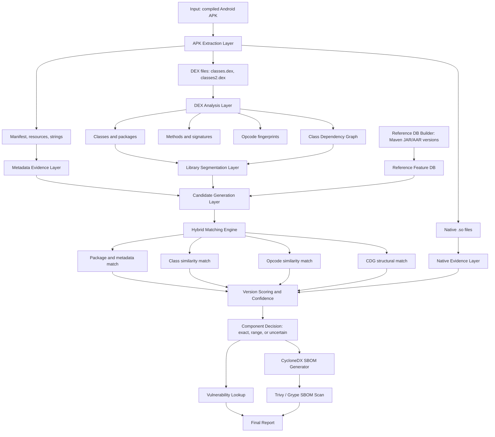

# MVP Architecture

## One-Sentence Description

The MVP is a static, hybrid APK-to-SBOM pipeline that extracts bytecode and metadata from compiled Android APKs, detects known Maven third-party libraries using class, opcode, and graph-based matching, estimates versions with confidence, emits a CycloneDX SBOM, and queries vulnerability sources for detected versions.

## Architecture Diagram



## Pipeline

```text
APK
-> extract DEX, manifest, resources, strings, native files
-> parse DEX into classes, methods, opcodes, and dependencies
-> build class dependency graph
-> segment likely third-party library code
-> generate candidate libraries from metadata and structural clues
-> compare against Maven reference versions
-> rank library/version candidates
-> emit exact version, version range, or uncertain result
-> generate CycloneDX SBOM
-> query vulnerability APIs
-> produce final report
```

## Main Modules

| Module | Responsibility | Main output |
|---|---|---|
| APK extraction | Extract APK contents. | DEX files, manifest, resources, native files. |
| Metadata extraction | Recover weak but useful clues. | package names, strings, permissions, domains. |
| DEX analysis | Recover comparable bytecode features. | classes, methods, opcodes, API calls, dependencies. |
| Reference DB builder | Build features from Maven library versions. | PURL, version metadata, class/method/opcode/CDG features. |
| Segmentation | Separate probable TPL modules from app code. | candidate module clusters. |
| Candidate generation | Reduce search space. | ranked library candidates. |
| Hybrid matching | Compare APK features to reference versions. | per-version evidence scores. |
| Version scoring | Decide exact/range/uncertain result. | confidence and candidate list. |
| SBOM generation | Emit standard SBOM. | CycloneDX JSON. |
| Vulnerability lookup | Query vulnerabilities for detected versions. | CVE/GHSA/OSV advisory list. |
| Reporting | Explain findings. | JSON/Markdown/HTML report. |

## Scope

The MVP supports:

- standard single APK files
- multidex
- Java/Kotlin Maven libraries
- selected known libraries in the reference DB
- basic obfuscation such as identifier renaming
- partial shrinking with lower confidence
- CycloneDX SBOM output
- vulnerability lookup through OSV first

The MVP does not promise:

- packed/encrypted APK support
- dynamic code loading support
- commercial protector support
- complete native `.so` version detection
- perfect heavy R8 recovery
- all-library global coverage

