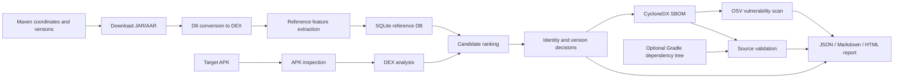

# End-to-End Architecture

## Two pipelines meet at the matcher

## Stage 1: inspect the APK

`apk_extractor.py` verifies that the target is a readable APK/ZIP, hashes the
file, finds DEX and native files, decodes manifest metadata, and records
forensic indicators such as nonstandard DEX paths or a native-heavy package.

## Stage 2: extract comparable DEX evidence

`dex_analyzer.py` parses every discovered DEX with Androguard. It aggregates
packages, classes, methods, fields, opcode counts, opcode tri-grams, class
dependencies, literals, API references, and diagnostic multi-scale features.

The same analyzer is used on reference artifacts after D8 conversion. This
common representation is important: comparisons are between DEX-like evidence,
not between source code and compiled APK code.

## Stage 3: retrieve reference candidates

The SQLite DB stores one component row per Maven coordinate/version and child
rows for each feature family. Optional coordinate filters or experimental
prefilters can reduce the candidate set.

Candidate reduction is dangerous: a fast prefilter that removes the true
version makes downstream scoring irrelevant. This is why prefilters are
guarded and evaluated separately.

## Stage 4: score and decide

The matcher computes per-feature similarities and a normalized weighted score.
It ranks versions, applies guarded artifact-family and version tie logic, and
derives:

- library identity confidence;
- exact-version confidence;
- selected, uncertain, or rejected status;
- ambiguous alternatives and evidence explanations.

## Stage 5: produce the SBOM

Accepted Maven detections become CycloneDX components with PURLs, confidence
properties, hashes where applicable, and evidence. Native `.so` observations
become hash-backed file components rather than invented Maven packages.

## Stage 6: scan vulnerabilities

Maven components are queried through OSV's batch API. Advisory details may be
enriched. Vulnerability certainty follows identity/version certainty and can be
further relabeled by source validation.

## Stage 7: validate and report

When an open-source dependency tree is available, emitted SBOM rows are checked
as confirmed, version-mismatch, or missing. The final report combines APK
metadata, detections, uncertainty, SBOM, vulnerabilities, and optional
report-only research sections.

## Authority boundaries

Production authority:

- stable extractor and DEX features;
- calibrated matcher decisions;
- SBOM emission and OSV classification;
- source-validation labels.

Non-authoritative attachments:

- R8 phase diagnostics;
- version-band experiments;
- AI suggestions;
- hybrid router recommendations;
- unpromoted large/priority DB results.

See [Safe experiment rules](../operations/SAFE_EXPERIMENT_RULES.md).
