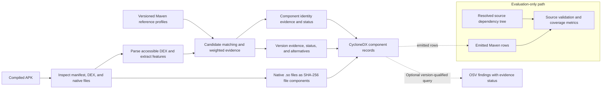
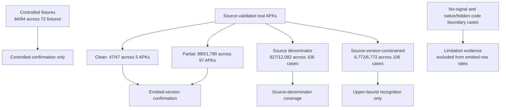

# Evidence-Gated Recovery of Maven Components from Compiled Android APKs

## 1. Abstract

Analysts often need to inventory third-party components from compiled Android
applications without access to source code or build metadata. This paper
presents an implemented static pipeline that compares DEX-derived features
with versioned Maven reference profiles, separates component identity from
exact-version evidence, preserves ambiguity, emits CycloneDX, and optionally
qualifies OSV findings according to the component/version evidence. In
retained source-validation summaries, 927/1,837 emitted Maven version rows
agree with source evidence across 102 APKs: 47/47 across five clean cases and
880/1,790 across 97 partial cases. In the later recorded controlled snapshot,
84/84 expected component-version rows are confirmed across 72 generated
fixtures; 30 fixtures/35 components is an earlier checkpoint. Against the broader source dependency
denominator, 927/12,082 rows are emitted exactly across 106 source-tree cases.
A separate 6,772/6,772 result uses per-APK exact source-version candidate
slices and is an upper-bound recognition analysis, not ordinary APK-only
performance. The examples demonstrate evidence-qualified SBOM and
vulnerability reporting, not vulnerability precision or recall. These figures
are transcribed from the retained theses and evaluation records; the current
checkout lacks some row-level inputs and run metadata needed for independent
recalculation, so the paper does not claim a fresh rerun.

## 2. Introduction

### 2.1 Context

Software bills of materials (SBOMs) support inventory and software supply-chain
risk management by recording the components that make up a software product
(National Telecommunications and Information Administration, n.d.; Boyens et al., 2022). An auditor of an Android application may
receive only the delivered APK, without its source tree, dependency
declarations, or build environment. The APK exposes compiled DEX files and
resources, rather than the original resolved dependency graph (Android
Developers, n.d.-a). During the build, D8 converts Java bytecode to DEX, and
R8 can remove, rewrite, and rename code (Android Developers, n.d.-c, n.d.-d).
Android libraries may also be packaged as AARs containing code alongside
resources, manifests, or native libraries, complicating a direct mapping from
visible bytecode to a published Maven artifact (Android Developers, n.d.-b).

For an APK-only analyzer, identifying a likely library is therefore only one
part of the task. The analyzer must also decide whether the available evidence
supports a particular release, communicate uncertainty to downstream SBOM
consumers, and avoid treating a tentative version as definitive vulnerability
evidence. These distinctions matter because a component inventory can guide
security review, but neither an SBOM format nor a vulnerability lookup
establishes that a candidate library is present in the packaged application.

### 2.2 Problem statement

This work studies the recovery of Maven component and version evidence from a
compiled Android APK using a versioned reference set. The target output is an
SBOM that retains the basis and strength of each attribution. We distinguish
three questions: whether evidence supports a component family, whether it
supports one exact published version, and whether that version evidence is
sufficient for a downstream vulnerability report.

The inference is affected by several independent limits. The reference set may
not contain the packaged artifact or release. Adjacent releases can have
similar bytecode; Android packaging can merge code into one or more DEX files;
and shrinking, renaming, optimization, or inlining can remove or alter useful
features (Backes et al., 2016; Wu et al., 2023; Xie et al., 2024). A Maven
coordinate may also be published through multiple JVM or Android artifact
variants. Native libraries, dynamically loaded code, and DEX content that the
parser cannot inspect impose additional boundaries. Thus, component identity,
exact-version attribution, and vulnerability interpretation cannot safely be
collapsed into a single match decision.

Source dependency trees help evaluate the implementation, but they answer a
different question from APK inspection. A resolved dependency may not survive
shrinking and packaging, while the APK can expose packaged code whose Maven
identity is not recoverable from a simple dependency declaration. The source
tree is therefore a validation proxy, not a complete oracle for what code is
present in the binary; this distinction is also reflected in benchmark work on
partial and transformed library code (Android Developers, n.d.-c; Zhan et al.,
2021b; Gu et al., 2025). An APK-only invocation cannot use source-side versions
as candidate hints without changing the task being evaluated. We therefore
keep source validation separate from ordinary APK-only matching and report
source-version-constrained recognition only as an upper-bound analysis.

### 2.3 Related work and motivation

Android third-party-library detection has used package and class profiles,
dependency graphs, opcode and call-chain features, structural similarity, and
learned representations. These methods address overlapping but distinct
tasks: finding a library family, distinguishing its versions, and remaining
useful after build transformations. LibScout established profile-based
matching, while ATVHunter connected version identification with
vulnerability-oriented analysis (Backes et al., 2016; Zhan et al., 2021a).
Later work studies more precise signatures and the effects of optimization
(Wu et al., 2023; Xie et al., 2024), and recent version-level work uses class
structural similarity (Zhou et al., 2025). Systematic assessment and benchmark
work further show why dataset construction, ground-truth units, reference
coverage, and transformation settings must be considered when interpreting
reported results (Zhan et al., 2021b; Gu et al., 2025).

This literature motivates two choices in our study. First, evaluation must
separate controlled fixtures, agreement for versions the tool emitted,
coverage of the full source-derived denominator, and source-version-constrained
recognition. These quantities have different denominators and support
different conclusions. Second, a practical APK-to-SBOM workflow should retain
supporting evidence and ambiguity through reporting, rather than turning every
plausible similarity into an unqualified component or vulnerability claim.
Section 3 develops the comparison and research gap in detail.

### 2.4 Approach overview

The implemented pipeline inspects APK metadata and successfully parsed DEX
files, extracts bytecode-derived features, and compares them with versioned
Maven reference profiles stored in a SQLite database. Its weighted evidence
fusion first shortlists component families and then ranks candidate versions.
It keeps identity evidence separate from version confidence and preserves
close alternatives when the evidence does not justify a single release. The
reporting layer emits CycloneDX components, records native files as
hash-identified file components, and can query OSV using the reported
component/version evidence. An advisory returned by that workflow is treated
as associated evidence, not independent proof of component presence or
exploitability.

The evaluation uses separate evidence lanes. Controlled fixtures measure
recovery against known expected versions. Clean and partial source-validated
APK cases measure agreement for emitted Maven versions. A separate analysis
measures coverage against the full source-derived coordinate/version set,
while a source-version-constrained lane tests recognition when candidate
versions are restricted using source evidence. The latter is reported as an
upper bound, not as normal APK-only performance. Cases with no Maven signal,
native-only or hidden code, and report-only experiments remain explicit
boundaries rather than being forced into an accuracy denominator.

### 2.5 Contributions and scope

This paper makes four bounded contributions:

1. It describes an implemented static pipeline for recovering Maven/JVM
   component and version evidence from compiled Android APKs and emitting
   CycloneDX.
2. It documents an evidence-aware reporting policy that separates component
   identity, exact-version confidence, ambiguity, native-file handling, and
   downstream vulnerability interpretation.
3. It evaluates the implementation through controlled and source-validated
   lanes, with each result tied to its unit, numerator, denominator, and
   coverage limits.
4. It records failure causes and rejected or report-only experiments to
   characterize practical limitations alongside successful cases.

The paper does not claim universal Android dependency recovery, complete
packaged-code recall, calibrated probabilistic confidence, native package or
version attribution, or vulnerability-detection precision. AI/R8 assistants
and structural rerankers remain diagnostic or report-only unless a separately
validated promotion gate changes that status. These scope limits define the
claims made throughout the paper; the numerical results are documented
snapshots, with independent-recalculation limits stated where the corresponding
raw artifacts and frozen run manifest are unavailable.

### 2.6 Paper organization

Section 3 presents the structured mapping review and synthesizes the research
gap. Section 4 describes the proposed evidence model, workflow, and decision
policy. Section 5 documents the implementation and experimental evaluation,
including research questions, protocol, results, discussion, and threats to
validity. Section 6 summarizes the findings, limitations, and future work.

## 3. State of the Art

This section synthesizes a structured mapping review of methods for recovering
third-party components from compiled Android applications, with emphasis on
library identity, exact-version attribution, build transformations, and
downstream SBOM or vulnerability use. The thesis protocol (version 1.0,
frozen 21 June 2026) searched ACM Digital Library, IEEE Xplore, SpringerLink,
ScienceDirect, USENIX, and arXiv; Google Scholar supported discovery and
citation chaining. Search terms combined Android/APK/DEX, component/SBOM,
recovery tasks, and transformation/version/vulnerability concepts. The seed
corpus was assembled iteratively before the protocol was frozen. Its original
database-specific query counts and deduplication flow were not retained, so
this review does not claim an exhaustive selection process or a systematic
review with a complete screening-flow count. Full-text claims in the core
synthesis rely on the 15 Tier A studies inspected under the protocol; five
Tier B records served as supplementary search leads, not independent support
for precise quantitative claims (Kitchenham & Charters, 2007; Zhan et al.,
2021b).

The comparison uses task granularity, evidence representation, version
support, transformation coverage, output, ground-truth construction, unit of
analysis, and artifact availability. We distinguish library-family presence
from exact-version detection and vulnerability interpretation. Reported
metrics remain attached to their original datasets and definitions; they are
not pooled into a ranking. A post-freeze search update is identified
separately where relevant.

Android TPL detectors use several overlapping evidence families. Profile-based
methods create reference signatures from known libraries and compare them
with code in an APK. LibScout represents a library through a profile hierarchy
and fuzzy method descriptors, which can tolerate some identifier changes
(Backes et al., 2016). Graph and class-structure methods reduce their reliance
on package names: LibD uses relations among classes and opcode-derived
fingerprints, while ORLIS uses a coarse call-graph-based filter followed by
class signatures and class mapping (Li et al., 2017; Wang et al., 2018).
LibPecker and LibID likewise use class dependencies or class correspondence
to identify library code when package layout alone is unreliable (Zhang et
al., 2018, 2019).

Later systems combine coarse candidate generation with more detailed
matching. ATVHunter uses class-dependency information to separate candidate
library code, then combines control-flow filtering and opcode-based matching
for version decisions (Zhan et al., 2021a). LibScan first constructs candidate
class correspondences from code features and refines them with method-opcode
and call-chain-opcode similarity; it also uses early stopping and intermediate
results to control analysis cost (Wu et al., 2023). These methods illustrate a
tradeoff: a coarse stage can make analysis tractable but can cap recall if it
omits a true candidate, while a permissive fine stage can admit false
correspondences. A library-level match should therefore be interpreted in
light of the candidate-generation and class-mapping evidence that produced it.

Learned representations form another line of work. LibAttention trains a
Transformer-based model over Smali-derived input for TPL presence detection
(Pan et al., 2025). This learned presence task is distinct from verifying a
Maven coordinate and its exact release. Across these approaches, the evidence
shift from package names toward signatures, relations, opcodes, and learned
features improves the range of available signals, but no signal is invariant
to every transformation or sufficient on its own for every claim type.

Exact-version attribution is a stricter task than detecting that a library
family is present. It requires evidence that distinguishes releases of the
same component, and its success is bounded by whether the correct artifact and
version occur in the reference corpus. ATVHunter connects version detection
with a downstream vulnerability database, combining coarse and fine-grained
bytecode evidence to report vulnerable library versions (Zhan et al., 2021a).
LibScan and LibHunter use increasingly detailed method, opcode, and call
context features; LibHunter specifically examines optimization effects such
as method inlining and call-site optimization (Wu et al., 2023; Xie et al.,
2024).

SAD makes version discrimination explicit through class-dependency graphs,
class summaries, and structural matching, with evidence such as field
operations and literals used to distinguish candidate classes and versions
(Zhou et al., 2025). Its study also defines a stricter version-level metric
that counts additional incorrect versions as false positives. On SAD's
obfuscated dataset, its reported version-level F1 is 84.82%; the value belongs
to that study's dataset and strict metric, and should not be compared directly
with results using another candidate construction or error definition (Zhou
et al., 2025). This accounting difference is consequential: a detector that
finds the right release while also emitting several wrong alternatives does
not provide the same version claim as one that returns only the supported
release.

These studies motivate reporting candidate ambiguity and exact-version
evidence separately from family identity. Adjacent releases may share most
classes and methods; changes in artifact packaging can also alter which
classes appear without changing the underlying project identity. If the
reference database lacks the actual version, an APK-side similarity match
cannot recover it as an exact candidate. Version coverage, matcher behavior,
and false-positive accounting must therefore be visible alongside any
version-level result.

Renaming, package flattening, shrinking, optimization, and method inlining
change different parts of an APK's observable code. Name-based evidence can
fail under renaming; shrinking can remove classes and methods; optimization
can rewrite or inline methods and change the relations on which opcode or
call-chain comparisons depend. Transformation resilience must consequently
be evaluated by transformation and by claim level rather than summarized as
one robustness property.

LibScan evaluates matching under obfuscation and code transformations, while
LibHunter focuses on how optimization strategies alter TPL detection and
introduces features for call-site optimization and inlining (Wu et al., 2023;
Xie et al., 2024). SAD's evaluation separately reports obfuscated and
optimized data, and identifies performance changes between those conditions
(Zhou et al., 2025). Together, the studies show that strong library-level
results do not guarantee equally strong exact-version results under the same
transformations. Small release-specific differences may be the very features
removed or merged by a build pipeline.

After the thesis protocol froze, a new arXiv preprint introduced LibFan, a
learning-based detector that combines context-aware method representations
with functional partitions to address aggressive transformations and partial
library reuse (Fan et al., 2026, preprint). It is a relevant emerging direction
for the transformation and partial-inclusion problem. Because it postdates
the frozen review and has not been incorporated into the original seed-corpus
screening and extraction record, it is cited here as a post-freeze update,
not as part of the 15-study core synthesis or as a directly comparable result.

Most of the reviewed Android TPL detectors evaluate matching and report
libraries, classes, versions, or vulnerability-related results. Their primary
evaluation targets are not complete, evidence-provenance-rich SBOM records.
ATVHunter demonstrates a version-aware path into vulnerability analysis, but
a vulnerability result still depends on the quality of component and version
attribution (Zhan et al., 2021a). UniBOM is adjacent work on an integrated
binary, filesystem, and source workflow that generates and analyzes SBOMs;
its firmware and IoT settings do not provide Android Maven exact-version
ground truth (Safronov et al., 2025).

This distinction is about evidence and authority, not merely output format. A
standard SBOM can encode component records (OWASP CycloneDX Project, n.d.;
SPDX Workgroup, n.d.), but format conformance alone does not establish that a
guessed component or version is present in an APK. Likewise, a vulnerability
database match against an uncertain version does not independently confirm
that version or show exploitability. The system studied here therefore treats
component evidence, version confidence, ambiguity, and downstream advisory
interpretation as separate report properties; this is the operational focus
of the proposed workflow.

Assessment and benchmark studies demonstrate why detector metrics need their
dataset and ground-truth construction. The systematic assessment evaluates
tools across separate criteria, including candidate-library construction,
effectiveness, efficiency, version identification, obfuscation resilience,
and usability (Zhan et al., 2021b). TPL-Benchmark presents 6,055 APK/source
pairs with version annotations and compares detectors on a defined subset of
that corpus. In its comparison slice, 946 applications and 28,210 valid
mappings are used; LibPecker's reported 60.15% library-level
F1 is specific to that candidate and evaluation protocol, not a general
accuracy ceiling (Gu et al., 2025). Differences in candidate set, reference
database, source mapping, transformation, and treatment of extra versions
make cross-study percentage ranking unsound.

**Table 1 — Related-work comparison.**

Table 1 summarizes representative methods along the dimensions used in this
review. It is a task-and-evidence comparison, not a leaderboard; each study's
quantitative results remain attached to its own dataset and metric.

| Study or line | Main task and evidence | Version/transformation scope | Relevance and comparison limit |
|---|---|---|---|
| LibScout (Backes et al., 2016) | TPL profiling with hierarchical package/class and fuzzy method evidence | Profile-based family and release matching; tolerates some identifier changes | Establishes profile matching as a baseline design; reference coverage bounds possible matches |
| LibD, ORLIS, LibPecker, and LibID (Li et al., 2017; Wang et al., 2018; Zhang et al., 2018, 2019) | Class, dependency-graph, call-graph, and opcode-derived structural signatures | Reduces dependence on package names and addresses selected obfuscation conditions | Shows alternative identity evidence; their datasets and class-correspondence rules are study-specific |
| ATVHunter (Zhan et al., 2021a) | Version detection through dependency-graph separation, control-flow filtering, and opcode matching | Explicit version and vulnerability-identification workflow | Motivates version-aware evidence; does not establish complete native/dynamic coverage or vulnerability precision |
| LibScan (Wu et al., 2023) | Fingerprint-based class correspondence refined by method- and call-chain-opcode similarity | Evaluates selected obfuscation and D8/R8 transformations; includes early stopping | Motivates coarse-to-fine matching; candidate generation and tuned transformation settings affect results |
| LibHunter (Xie et al., 2024) | Empirical analysis of optimization effects with features for inlining and call-site optimization | Focuses on selected R8 optimization strategies and transformation variants | Motivates transformation-specific evaluation; results do not establish universal R8 invariance |
| SAD (Zhou et al., 2025) | Version-level detection using class-dependency graphs, structural summaries, and class matching | Reports obfuscated/optimized conditions and a strict version-level metric | Highlights extra-version false-positive accounting; its reported metrics remain dataset-specific |
| LibAttention (Pan et al., 2025) | Transformer-based representation over Smali for TPL-presence detection | Learned representation evaluated for the study's presence task | Motivates learned evidence; library presence does not itself establish an exact Maven release |
| TPL-Benchmark (Gu et al., 2025) | Multi-tool empirical comparison over version-annotated APK/source pairs | 6,055 pairs overall; a 946-app/28,210-mapping comparison slice | Demonstrates benchmark-construction and denominator sensitivity; its metric is not a cross-study ceiling |
| UniBOM (Safronov et al., 2025) | Integrated binary/filesystem/source SBOM and vulnerability workflow | Firmware/IoT-oriented evaluation rather than Android Maven exact-version ground truth | Motivates end-to-end reporting; does not provide a directly comparable Android version benchmark |

The common methodological lesson is to state what was detected, what counted
as ground truth, the unit and denominator, transformation conditions, and
whether the reference corpus could contain the target release. The same
discipline applies to the present evaluation: controlled fixtures, emitted
version confirmation, full source-denominator coverage, and
source-version-constrained recognition are different evidence lanes and must
remain separate.

Within the reviewed Android TPL and adjacent SBOM corpus, the operational gap
addressed by this paper is the connection between binary-derived component
evidence and a downstream SBOM/vulnerability workflow that preserves
provenance, version uncertainty, coverage limits, and validation class. This
is a bounded characterization of the implementation, not a claim that no
prior detector performs version identification or that the system is
universally novel or superior. The following section describes how the
implementation represents and reports these distinct evidence types.

## 4. Proposed Approach

The input is a compiled Android APK; the target is Maven/JVM code represented
in accessible DEX files. The approach inspects the APK, extracts package,
class, method, opcode, literal, API-reference, and class-dependency evidence,
and compares it with versioned Maven reference profiles. Source dependency
trees are reserved for evaluation and explicit validation, not candidate
generation in the ordinary APK-only path. Native `.so` files receive
hash-identified file records rather than Maven package/version attribution.

For each reference, the matcher computes feature-level overlap or similarity
and combines enabled signals with normalized weighted scoring. The stored
evidence includes the per-signal scores and matched/reference counts. This
score is a ranking and decision input, not a calibrated probability; absent
references, correlated signals, and transformed or partially retained code
can limit its meaning.

The decision process separates component-family identity from release
selection. Identity and version confidence have distinct values, labels, and
statuses. Identity statuses are `confirmed`, `likely`, `candidate`, or
`uncertain`; version statuses are `exact`, `likely`, `candidate`, or
`uncertain`. Version selection considers competing releases and version-unique
evidence under bounded score and identity gates; ties and feature-equivalent
releases can remain ambiguous. A lone version in the reference database is
not automatically treated as exact without sufficient supporting evidence.

CycloneDX properties preserve the chosen coordinate/version, evidence,
identity and version confidence, statuses, and alternative versions when
available. A missing library or version can result from incomplete reference
coverage, parsing limits, transformations, candidate-generation loss, or
ambiguity; these causes are not interchangeable. Dynamic or encrypted code,
native component identity, and parser-inaccessible DEX remain outside the
method's reliable recovery boundary.

The official decision path uses only signals that passed promotion gates. The
composite family shortlist and version-unique literal/context reranker are
narrowly gated defaults. Broader global R8 blending, AI suggestions, and
additional structural features remain diagnostic, experiment-only, or
report-only; they do not change selected components, versions, SBOM output, or
vulnerability labels.

### 4.6 Report-only R8 and AI assistance workflow

The project also implemented a report-only assistance path for R8-risk and
evidence triage. Its structured dataset contains 20,523 rows grouped into 149
case identifiers, with 14,905 training rows, 1,750 validation rows, and 3,868
test rows. The split is performed by case identifier so rows from one APK case
do not cross the partitions. The labels describe project evidence states such
as confirmed exact, risk-only, boundary, report-only suggestion, suppressed
uncertainty, and mismatch/extra evidence; they are not independently annotated
universal APK ground truth.

The Phase 6A model is a balanced Random Forest using 17 evidence features,
including identity confidence, matcher scores, dependency and opcode signals,
and boundary/context indicators. Phase 6B evaluates a structured-token
Transformer with a full profile and a safer source-free profile. The full
profile contains source and candidate-version tokens that can encode shortcuts;
the safer profile removes source-version, raw candidate-version, coordinate,
rank, and diagnostic context fields while retaining source-free feature
groups, candidate-version shape, and R8/minification indicators. A separate
raw-opcode Transformer uses method opcode sequences from 14 APK cases to test
whether opcode sequences alone support R8-profile triage.

At inference time, these models produce report sections, risk indicators, or
investigation suggestions alongside the deterministic matcher output. They do
not select Maven versions, add or remove CycloneDX components, change OSV
labels, or alter source-validation metrics. This boundary is enforced by an
explicit integration gate and was checked with a two-target smoke test. The
models therefore evaluate assistance and triage, not production APK-only
version attribution.

OSV lookup follows component/version selection (Open Source Vulnerabilities
Project, n.d.). Findings are marked confirmed only when component identity is
supported and version evidence is high/exact under the current policy;
otherwise they remain potential. Explicit source validation can further
qualify a finding but is not silently merged with APK-only evidence. This is a
claim-handling policy, not a vulnerability precision, recall, or exploitability
evaluation.

### Figure 1 — APK-to-SBOM evidence workflow



The source-tree validation path is outside ordinary APK-only candidate
generation. Native-file records carry hashes only and do not assert Maven
identity or version. This Mermaid diagram is a working source; export it to the
selected venue's vector format after the final terminology audit.

### Figure 2 — Evaluation lanes and claim boundaries



The lanes use different units and evidence conditions. The constrained lane
restricts candidate references with source-known versions and therefore cannot
be interpreted as ordinary APK-only performance.

## 5. Implementation and Experimental Evaluation

### 5.1 Research questions

The evaluation addresses four questions:

- **RQ1 — Controlled recovery:** How well does the pipeline recover expected
  Maven coordinates and versions in controlled APK fixtures, including
  selected rename, shrink, optimization, and multidex variants?
- **RQ2 — Real-APK version confirmation:** Among Maven versions emitted for
  source-validated real APKs, what fraction agrees with the resolved source
  dependency evidence, and how does this differ between clean and partial
  cases?
- **RQ3 — Coverage and failure causes:** How much of the resolved source
  coordinate/version denominator is emitted exactly, and what documented
  gaps are associated with reference coverage, matcher/reporting, version
  ambiguity, artifact-family variants, metadata-only dependencies, or other
  boundaries?
- **RQ4 — Downstream claim handling:** How does the pipeline preserve evidence
  and uncertainty in CycloneDX and vulnerability reports? This is a workflow
  question, not a vulnerability-detection precision or recall study.

### 5.2 Implementation under evaluation

The command-line application is `apk-sbom-mvp` version 0.1.0 and requires
Python 3.12 or later. APK inspection reads archive and manifest data; DEX
analysis uses Androguard and aggregates features from accessible DEX files.
The reference path downloads versioned Maven artifacts, converts compatible
JAR/AAR inputs to DEX for comparable analysis, and stores component metadata
and features in SQLite. These are the implemented stages; the database
snapshot used for each reported result is not included in the project archive
available for independent replication.

The matcher aggregates package, class, method, opcode, dependency, literal,
and version-unique evidence with normalized configurable weights. In the
current source defaults, package/class/method/opcode/dependency/literal/
version-unique weights are 0.15/0.45/0.25/0.15/0.10/0.08/0.12; API-reference
and opcode-ngram weights are zero. These parameters are implementation
settings, not learned coefficients or calibrated probabilities. The default
decision path enables a composite family shortlist (margin 0.10 and complete
retained version bands) and a guarded version-unique literal/context near-tie
reranker. The latter requires at least two matched unique features, a unique
score of at least 0.10, an advantage of at least 0.05, raw-score distance no
greater than 0.020, and the identity and minimum raw-score gates.

The output serializer emits CycloneDX 1.5, including Maven Package URLs,
evidence and identity/version properties, and ambiguity details when present.
Native `.so` files become SHA-256-identified file components without Maven
identity/version attribution. OSV lookup is optional at the report command;
reported findings are classified using identity and version evidence, and an
explicit source-validation artifact can further relabel them. The pinned
repository dependencies include Androguard 4.1.3, NetworkX 3.4.2, Requests
2.32.3, Packaging 24.2, Pydantic 2.10.6, and Rich 13.9.4. These are the
declared project dependencies, not a substitute for a frozen environment
manifest from the evaluation runs. The values above describe the current
source defaults; the absent run manifest prevents verification that the
historical result snapshot used these same settings.

Optional R8 experiments, version-band diagnostics, AI suggestions, and
additional structural features are not part of the authoritative default
selection path unless an explicit promotion record enables a narrowly gated
behavior. The CLI describes these additions as opt-in and report-only; they do
not change selected components or versions, CycloneDX content, vulnerability
labels, or source-validation metrics. Section 4 describes the method-level
evidence model; this subsection records concrete implementation behavior.

### 5.3 Experimental protocol and datasets

The project distinguishes controlled fixtures, source-validated real APKs,
source-denominator analysis, source-version-constrained recognition,
no-Maven-signal controls, and boundary examples. Their units and permitted
interpretations differ, so results are reported separately.

### Controlled fixtures

The retained evaluation record describes a staged controlled-set expansion:
an earlier checkpoint covered 30 generated APK fixtures and 35 expected Maven
components; the later thesis-facing snapshot covers 72 fixtures and 84
expected component/version rows. The later aggregate is used below as the
final recorded controlled result. The fixtures cover clear cases and selected
package-flattening, rename, shrink, optimization, multidex, and multi-library
variants. The paper transcribes the recorded results; it does not claim a new
run or independent recalculation from the generated fixture batch.

### Source-validated real APKs

The retained primary real-APK summary covers 102 source-validated APKs that
emitted Maven rows: five clean cases and 97 partial cases. Four additional
source-validated APKs emitted no Maven component rows. Those controls are
reported separately and excluded from rates whose denominator is emitted
Maven rows. Source dependency trees are used to validate emitted coordinates
and versions, but remain source-side evidence: they do not prove that each
resolved dependency is present in the final packaged APK.

The source-denominator layer contains 106 source-tree cases (the 102
Maven-emitting cases plus four no-signal controls). The broader 110-case
transparency inventory also includes four native-heavy, hidden-code, or
obfuscation boundary examples. Those four cases do not expand the 106-case
source-tree denominator or the 102-case emitted-version denominator.

Some dependency trees were collected using validation-only copies, selected
Gradle configurations, or toolchain/build-rescue modifications. The available
project archive does not contain all source trees or per-case validation
exports needed to enumerate and independently verify every modification.
Source tags/commits, APK hashes, configurations, and validation-copy changes
are likewise unavailable for complete case-level reproduction.

**Table 2 — Evaluation strata and metric eligibility (retained snapshots).**

| Evidence stratum | Cases | Checked unit or denominator | Metric eligibility and qualifier |
|---|---:|---|---|
| Controlled fixtures | 72 | 84 expected component/version rows | Final recorded controlled-set snapshot after the earlier 30-fixture/35-component checkpoint; expected-row confirmation in generated fixtures only |
| Clean source-validated | 5 | 47 emitted Maven version rows | Emitted-version confirmation; sparse clean cases limit generalization |
| Partial source-validated | 97 | 1,790 emitted Maven version rows | Emitted-version confirmation; report partial stratum separately |
| Combined Maven-emitting set | 102 | 1,837 emitted Maven version rows | Combined emitted-version confirmation; not full source dependency recall |
| No-Maven-signal controls | 4 | Zero emitted Maven rows | Case-level control only; no emitted-row rate is defined |
| Full source-denominator layer | 106 | 12,082 source coordinate/version rows | Source-denominator coverage, reported separately from emitted-row confirmation |
| Source-version-constrained analysis | 106 | 6,772 source-constrained emitted rows | 6,772/6,772 upper-bound recognition using per-APK exact source-version slices; not ordinary APK-only performance |
| Additional boundary cases | 4 additional, within the 110-case inventory | Native-heavy, hidden-code, or obfuscation boundary evidence | Limitation examples only; outside the 106-case source-tree denominator and 102-case emitted-row set |

The 106 source-tree cases comprise the 102 Maven-emitting cases and four
no-signal controls. The broader 110-case inventory adds four boundary cases;
it does not change the denominator of either source-tree measure. The counts
above are transcribed from the retained thesis and evaluation records. The
machine-readable package needed to regenerate every aggregate is not present
in this checkout, so the paper identifies these as documented snapshots.

**Table 3 — Main recorded results and claim scope.**

| Evaluation lane | Recorded result | Unit and denominator | Permitted interpretation |
|---|---:|---|---|
| Controlled fixtures | 84/84 (100.0%) | Expected component-version rows across 72 generated fixtures | Controlled fixture confirmation only |
| Clean source-validated APKs | 47/47 (100.0%) | Emitted Maven version rows across 5 APKs | Emitted-version confirmation; sparse clean stratum |
| Partial source-validated APKs | 880/1,790 (49.2%) | Emitted Maven version rows across 97 APKs | Partial-stratum emitted-version confirmation |
| Combined Maven-emitting APKs | 927/1,837 (50.5%) | Emitted Maven version rows across 102 APKs | Overall emitted-version confirmation, not full dependency recall |
| Full source-denominator layer | 927/12,082 (7.7%) | Source coordinate/version rows across 106 source-tree cases | Source-denominator coverage, not packaged-code recall |
| Source-version-constrained analysis | 6,772/6,772 (100.0%) | Emitted rows after per-APK exact source-version candidate slicing across 106 cases | Upper-bound recognition under source-known version constraints |

The percentages are secondary to the counts. The clean and partial rows are
not pooled with the controlled lane, and the source-version-constrained result
is not an APK-only production score.

### Coverage and source-version-constrained analyses

The shared-reference coverage snapshot uses 12,082 source coordinate/version
rows across the 106 source-tree cases. Its dashboard records 2,220 rows whose
coordinate occurs in the shared database and 1,231 rows whose exact source
version occurs there. These are historical coverage counts, not precision
measurements. A separate source-version-constrained v2 experiment used a
10,517-component evaluation database and per-APK reference slices restricted
to exact source-known coordinate/version pairs. That restriction makes the
experiment an upper-bound recognition analysis, not normal APK-only matching.

The associated v2 gap summary classifies 5,238 source-gap rows. Among its
diagnostic categories, 2,281 are matcher-recall candidates and 442 are
missing-reference candidates; the other rows include artifact-family,
metadata/source-only, source/platform, and related boundaries. These
classifications are retained snapshot summaries and require the row-level
exports and matching database to reproduce.

### Vulnerability workflow cases

RQ4 uses two documented examples: a clean F-Droid report with no returned OSV
findings and a controlled Jackson Databind 2.9.10.8 fixture with three
returned advisories. They demonstrate evidence-qualified report behavior.
Neither example is a vulnerability gold standard, and the first is not
evidence that the APK contains no vulnerable component.

### 5.4 Metrics and denominator contracts

Each reported quantity has a different unit and interpretation:

| Measure | Unit and numerator/denominator | Permitted interpretation |
|---|---|---|
| Controlled expected-version confirmation | Expected component/version rows confirmed among 84 expected rows, across 72 fixtures in the retained thesis snapshot | Controlled behavior only; not real-APK accuracy |
| Emitted-version confirmation | Emitted Maven version rows agreeing with source evidence / checked emitted Maven version rows; 1,837 rows across 102 APKs | Quality of emitted versions; not full dependency recall |
| Source-denominator coverage | Source-observed coordinate/version rows emitted exactly / all source rows; 927/12,082 across 106 source-tree cases | End-to-end coverage against source dependencies; not proof of packaged-code recall |
| Shared-reference coverage | Source rows with coordinate or exact version in the shared DB / 12,082 source rows | Reference-set coverage; not matcher precision |
| Source-version-constrained recognition | Emitted rows confirmed under per-APK exact source-version candidate slices / checked emitted rows; 6,772/6,772 across 106 cases | Upper-bound recognition under known source versions only |

The real-APK primary measure is the **emitted Maven version confirmation
rate**:

```text
confirmed emitted Maven coordinate/version rows
------------------------------------------------
checked emitted Maven coordinate/version rows
```

It counts agreement for rows the tool emitted. It does not count source rows
the tool missed, and it is not named precision, recall, or accuracy. The
source-denominator measure uses a different denominator and must be kept in a
separate table or clearly separated row. Zero-emission controls have no
emitted-row rate; they remain a separate case count. Percentages are secondary
to counts and use consistent rounding from the documented evaluation records.

No cross-paper baseline is included because the published studies use
different candidate construction, reference coverage, transformations, and
false-positive rules. Earlier project baselines on a smaller controlled set
are not merged with the retained 72/84 or real-APK lanes.

### 5.5 Results by research question

### RQ1 — Controlled recovery

The final recorded thesis snapshot reports 84 of 84 expected component/version
rows confirmed across 72 controlled fixtures. The project task history records
an earlier 30-fixture/35-component checkpoint before the controlled inventory
was expanded. Rename and shrink evidence is reported cautiously as a
candidate, rather than as exact-version authority. This result characterizes
the generated fixtures; it does not estimate performance on a population of
Android apps.

### RQ2 — Real-APK emitted-version confirmation

| Stratum | Confirmed / checked emitted versions | APKs | Rate |
|---|---:|---:|---:|
| Clean source-validated | 47/47 | 5 | 100.0% |
| Partial source-validated | 880/1,790 | 97 | 49.2% |
| Combined source-validated | 927/1,837 | 102 | 50.5% |

The clean result comes from only five APKs, and several have sparse emitted
rows. It should not be generalized from this small stratum. The combined
result means that 927 emitted Maven version rows agree with the source-side
validation evidence among 1,837 checked emitted rows. The retained dashboard
classifies 636 rows as version mismatches and 274 as missing from the source
tree. These are not automatically equivalent to packaged-code false positives
because source resolution and APK packaging are different observations.

### RQ3 — Source coverage and failure causes

The retained source-denominator summary reports 927 exact emitted rows among
12,082 source coordinate/version rows across 106 source-tree cases (7.7%). In
the shared-reference snapshot, 2,220/12,082 source rows (18.4%) have a
coordinate represented and 1,231/12,082 (10.2%) have the exact source version
represented. This gap between output confirmation and denominator coverage
shows why an emitted-row rate alone does not characterize end-to-end coverage.

In the separate v2 source-version-constrained analysis, 6,772/6,772 emitted
rows are reported as exact confirmations across the 106 cases. The exact
source-known versions were used to restrict each APK's candidate reference
slice, so this is an upper-bound recognition result, not the APK-only matcher
result. Its 5,238 non-emitted source-gap rows include the documented
2,281 matcher-recall candidates and 442 missing-reference candidates, along
with alias, metadata/source-only, and platform or project boundaries. These
categories are reported as triage of the retained v2 snapshot, not as a
complete row-level causal attribution; the underlying row-level exports are
not available here for independent recalculation.

### RQ4 — Evidence-qualified vulnerability reporting

The clean F-Droid example returned no OSV findings; the controlled Jackson
Databind 2.9.10.8 example returned three advisories. In the implementation,
identity/version evidence controls whether a returned advisory is labeled
confirmed or potential, and explicit source validation can add a separate
validation status. The two examples demonstrate workflow behavior only; they
do not estimate vulnerability precision, recall, exploitability, or risk.

### Rejected and report-only experiments

The project retained failed experiments as decision evidence. A global R8
blend was not promoted after regression checks. The examiner/decision-ledger
snapshot and the expanded Phase-4 diagnostics report different improvement and
regression counts and denominators; without the run manifest, this paper
records the qualitative rejection only and does not merge those counts.
Scoped R8 triggers and AI suggestions remain report-only where controls do not
justify changing matcher or SBOM authority. Source-specific reference
additions that improved a target APK but introduced regressions elsewhere
were not promoted globally. An APK-only version-band candidate expansion with
no safe APK-only fixes likewise remains outside the default selection path.
These decisions answer why the shipped pipeline is conservative; they are not
additional population accuracy scores.

### 5.6 — R8 and AI report-only experiments

R8 and learned assistance were evaluated as supporting evidence rather than
as replacements for the deterministic matcher. The controlled fixture matrix
included rename, shrink, optimize, shrink-plus-optimize, package
flattening/repackaging, inline-like call-site stress, and multidex cases. The
final controlled result therefore includes transformation stress, but it is
reported as the controlled 84/84 result rather than as a separate claim of
universal R8 robustness.

The broader Phase-4 R8 blend was not promoted because its diagnostic snapshot
showed target improvements together with controlled and real-app regressions.
The retained examiner and expanded diagnostic records use different inputs and
denominators, so their counts are not combined here. A narrower Phase-5 trigger
was evaluated on 286 rows and passed 11 validation gates; its four opt-in
target reports produced four separate suggestions and zero default selection
changes. It remains experiment-only and does not alter the default matcher,
CycloneDX output, or vulnerability labels.

The AI experiments used project-derived evidence rather than an independent
Android benchmark. A Random Forest report-triage model reached approximately
0.708 test macro-F1. A structured-token Transformer reached approximately
0.977 macro-F1 with the full profile and 0.882 with a safer source-free
profile. The full-profile result may contain shortcuts related to the way
project labels were generated, so it is not APK-only deployment performance.
The raw-opcode Transformer reached approximately 0.110 macro-F1 and did not
beat the simple opcode-count baseline; it was therefore classified as
research-only and not promotable.

The integration gate permits AI evidence to appear in reports and triage, but
forbids automatic changes to selected versions, CycloneDX components, OSV
labels, or source-validation metrics. A two-target smoke test confirmed that
including the hybrid/AI report sections left detected components, selected
versions, CycloneDX content, and vulnerability output unchanged. These results
justify the evidence-gating policy, but they do not establish AI-based APK
version-detection accuracy.

### 5.7 Discussion

RQ1 shows strong confirmation in generated fixtures under the final recorded
controlled snapshot. RQ2 shows a higher emitted-version
confirmation rate in the small clean stratum than in the larger partial
stratum, while its aggregate remains an emitted-row measure. RQ3 shows that
reference coverage and matcher/reporting gaps constrain how much of the source
dependency denominator is emitted; the source-version-constrained result
isolates recognition only after source versions restrict the candidate set.
RQ4 confirms that the reporting workflow can preserve evidence qualifications
for example findings, but no vulnerability accuracy conclusion follows.

Taken together, the evidence supports a bounded account of useful version
confirmation with visible reference, transformation, and scope limits. It
does not support universal APK dependency recovery or independent real-world
recall estimates. The rejected experiments also show that an apparent target
improvement is insufficient for default promotion when control or real-app
regressions remain.

### 5.8 Threats to validity

- **Internal validity:** The reference database and its calibration history
  are absent; some evaluated APKs or app families may have contributed to
  reference-version selection. Threshold and promotion choices, evaluator
  behavior, database snapshots, validation-only source copies, and external
  OSV responses can affect the reported outcomes. The retained R8 Phase-4
  diagnostic records use different counts and denominators; the paper reports
  their common qualitative decision rather than combining them.
- **External validity:** Source-available and F-Droid apps do not represent all
  Android applications. The sample may be imbalanced by app family and build
  system. Native-heavy apps, commercial protectors, dynamic loading, encrypted
  payloads, and unsupported ecosystems remain outside reliable coverage.
- **Construct validity:** A Gradle runtime dependency tree is source-side
  evidence, not an oracle for code packaged in the final APK. Emitted-version
  confirmation is not full dependency recall. Rule-based confidence labels
  are not calibrated probabilities, and CycloneDX validity does not prove
  attribution correctness.
- **Conclusion validity:** The clean subset is small, APKs may be grouped by
  application family, and rows within an APK are not independent. Missing
  row-level exports prevent recalculating uncertainty or conducting a
  per-family analysis. The retained summaries therefore do not support
  significance claims or independently reproduced population estimates.

### 5.9 Reproducibility status

The numerical results and experiment decisions are recorded in the PFE and
master theses, evaluation dashboards, controlled-evaluation notes, and project
history. This paper uses those records and does not rerun the experiments. The
current checkout does not include all machine-readable row exports, generated
fixture APKs, reference-database snapshot, APK/source hashes, source revisions,
or frozen run manifest needed to independently regenerate every aggregate.
Accordingly, the paper identifies the figures as documented evaluation
snapshots and does not claim independent recalculation. The PFE evaluation
chapter identifies its principal evidence snapshot as 20 June 2026 and ties it
to implementation commit `2983d54`; the thesis and evaluation records remain
the cited provenance for the reported results.

## 6. Conclusion

This paper presents an implemented static workflow for recovering Maven
component and version evidence from compiled Android APKs and carrying that
evidence into CycloneDX and optional OSV reporting. The approach separates
component-family identity from exact-version support, retains alternatives
when evidence is ambiguous, and treats native files and inaccessible code as
explicit boundaries. Its weighted scores and confidence labels are
rule-based; they are not calibrated probabilities.

The retained evaluation snapshots show different outcomes across evidence
lanes. The thesis-facing controlled snapshot documents 84/84 expected-version
rows across 72 generated fixtures, while source-validated real APKs document a
927/1,837 emitted Maven version confirmation rate across 102 APKs, with clean
and partial strata reported separately. The source-denominator summary records
927 exact emitted
rows among 12,082 source dependency rows across 106 source-tree cases. A
separate 6,772/6,772 result applies only when per-APK candidate references are
restricted to exact source-known versions; it is an upper-bound recognition
analysis, not ordinary APK-only performance. These values are documented in
the retained thesis and evaluation records; the paper transcribes those
snapshots without rerunning the experiments or independently recomputing them
from row-level exports. The 30-fixture/35-component count is an earlier
controlled-set checkpoint, followed by the final recorded 72-fixture/84-row
snapshot.

The results therefore support a bounded conclusion: the implementation can
produce useful version evidence in controlled and some source-validated
cases, while reference coverage, transformations, ambiguity, and the
source-to-package gap limit end-to-end coverage. The OSV examples demonstrate
how the report distinguishes stronger from weaker component/version evidence;
they do not establish vulnerability precision, recall, or exploitability.
Rejected R8, structural, reference-promotion, and AI experiments further
support keeping unvalidated signals outside default SBOM and vulnerability
authority.

The principal limitations are the lack of a complete machine-readable
reproduction package in the current checkout, potential
overlap between evaluated applications and reference-version selection,
source dependency trees as an imperfect proxy for packaged code,
source-available sample bias, non-independent rows within APK families, and
limited handling of native, dynamic, packed, encrypted, and protected code.
The documented aggregates cannot be independently regenerated from this
checkout without their row-level inputs and run manifests, and they do not
support population-level generalization.

Future work should release a frozen machine-readable evaluation package;
report grouped
held-out or leave-one-app-family-out results; expand reference coverage while
separating evaluation-only references from globally promoted references;
improve APK-only candidate recall and version discrimination under R8 and
partial library inclusion; calibrate confidence on independent data; and
evaluate vulnerability claims against an explicit component/version oracle.

## References

Android Developers. (n.d.-a). *Analyze your build with the APK Analyzer*.
Retrieved September 29, 2026, from
https://developer.android.com/studio/debug/apk-analyzer

Android Developers. (n.d.-b). *Create an Android library*. Retrieved
September 29, 2026, from
https://developer.android.com/studio/projects/android-library

Android Developers. (n.d.-c). *Enable app optimization with R8*.
Retrieved September 29, 2026, from
https://developer.android.com/topic/performance/app-optimization/enable-app-optimization

Android Developers. (n.d.-d). *d8*. Retrieved September 29, 2026, from
https://developer.android.com/tools/d8

Backes, M., Bugiel, S., & Derr, E. (2016). Reliable third-party library
detection in Android and its security applications. In *Proceedings of the
2016 ACM SIGSAC Conference on Computer and Communications Security* (pp.
356–367). https://doi.org/10.1145/2976749.2978333

Boyens, J., Smith, A., Bartol, N., Winkler, K., Holbrook, A., & Fallon, M.
(2022). *Cybersecurity supply chain risk management practices for systems and
organizations* (NIST Special Publication 800-161 Revision 1).
https://doi.org/10.6028/NIST.SP.800-161r1

Fan, D., Zhang, J., Shi, Y., Luo, C., Liu, X., Liu, Y., Hu, C., & Wang, X.
(2026). *Context-aware functional modeling for Android third-party library
detection* (arXiv:2609.31409, version 1). https://doi.org/10.48550/arXiv.2609.31409

Gu, J., Lu, H., Nan, G., Lin, Y., Wang, K., Guo, Y., Cao, Y., & Liu, Y.
(2025). *Revisiting third-party library detection: A ground truth dataset and
its implications across security tasks* (arXiv:2509.04091).
https://doi.org/10.48550/arXiv.2509.04091

Kitchenham, B., & Charters, S. (2007). *Guidelines for performing systematic
literature reviews in software engineering* (EBSE Technical Report
EBSE-2007-01). Keele University and Durham University.
https://www.elsevier.com/__data/promis_misc/525444systematicreviewsguide.pdf

Li, M., Wang, W., Wang, P., Wang, S., Wu, D., Liu, J., Xue, R., & Huo, W.
(2017). LibD: Scalable and precise third-party library detection in Android
markets. In *Proceedings of the 39th International Conference on Software
Engineering* (pp. 335–346). https://doi.org/10.1109/ICSE.2017.38

National Telecommunications and Information Administration. (n.d.).
*Software bill of materials*. Retrieved September 29, 2026, from
https://www.ntia.gov/page/software-bill-materials

OWASP CycloneDX Project. (n.d.). *CycloneDX specification*. Retrieved
September 29, 2026, from https://cyclonedx.org/specification/overview/

Open Source Vulnerabilities Project. (n.d.). *OSV API documentation*.
Retrieved September 29, 2026, from https://google.github.io/osv.dev/api/

Pan, D., Xu, Y., Feng, R., Yu, D., Chen, J., Fang, Y., & Zhang, Y. (2025).
Pay your attention on Lib! Android third-party library detection via feature
language model. In *Proceedings of the IEEE International Conference on
Software Analysis, Evolution and Reengineering* (pp. 217–228).
https://doi.org/10.1109/SANER64311.2025.00028

Safronov, V., Bostan, I., Allott, N., & Martin, A. (2025). UniBOM: A unified
SBOM analysis and visualisation tool for IoT systems and beyond. In
*Proceedings of the 15th International Conference on the Internet of Things*
(pp. 86–94). https://doi.org/10.1145/3770501.3770512

SPDX Workgroup. (n.d.). *SPDX specifications*. Retrieved September 29, 2026,
from https://spdx.dev/use/specifications/

Wang, Y., Wu, H., Zhang, H., & Rountev, A. (2018). ORLIS: Obfuscation-resilient
library detection for Android. In *Proceedings of the 5th IEEE/ACM
International Conference on Mobile Software Engineering and Systems*.
https://doi.org/10.1145/3197231.3197248

Wu, Y., Sun, C., Zeng, D., Tan, G., Ma, S., & Wang, P. (2023). LibScan: Towards
more precise third-party library identification for Android applications. In
*Proceedings of the 32nd USENIX Security Symposium* (pp. 3385–3402). USENIX
Association. https://www.usenix.org/conference/usenixsecurity23/presentation/wu-yafei

Xie, Z., Wen, M., Li, T., Zhu, Y., Hou, Q., & Jin, H. (2024). How does code
optimization impact third-party library detection for Android applications?
In *Proceedings of the 39th IEEE/ACM International Conference on Automated
Software Engineering*. https://doi.org/10.1145/3691620.3695554

Zhan, X., Fan, L., Chen, S., Wu, F., Liu, T., Luo, X., & Liu, Y. (2021a).
ATVHunter: Reliable version detection of third-party libraries for
vulnerability identification in Android applications. In *Proceedings of the
43rd IEEE/ACM International Conference on Software Engineering* (pp.
1695–1707). https://doi.org/10.1109/ICSE43902.2021.00150

Zhan, X., Liu, T., Liu, Y., Liu, Y., Li, L., Wang, H., & Luo, X. (2021b). A
systematic assessment on Android third-party library detection tools.
*arXiv:2108.01964*. https://doi.org/10.48550/arXiv.2108.01964

Zhang, Y., Dai, J., Zhang, X., Huang, S., Yang, Z., Yang, M., & Chen, H.
(2018). Detecting third-party libraries in Android applications with high
precision and recall. In *Proceedings of the 25th IEEE International
Conference on Software Analysis, Evolution and Reengineering* (pp. 141–152).
https://doi.org/10.1109/SANER.2018.8330204

Zhang, J., Beresford, A. R., & Kollmann, S. A. (2019). LibID: Reliable
identification of obfuscated third-party Android libraries. In *Proceedings
of the 28th ACM SIGSOFT International Symposium on Software Testing and
Analysis*. https://doi.org/10.1145/3293882.3330563

Zhou, B., Wu, J., Ling, X., Luo, T., & Zhang, J. (2025). Version-level
third-party library detection in Android applications via class structural
similarity. In *Proceedings of the 29th International Conference on
Evaluation and Assessment in Software Engineering* (pp. 604–615).
https://doi.org/10.1145/3756681.3756933
