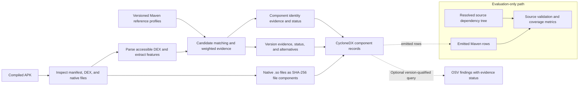

# Section 4 — Proposed Approach (Working Draft)

## 4.1 Problem model and assumptions

The input is a compiled Android APK. The principal recovery target is Maven/JVM
code represented in DEX. The approach compares evidence extracted from that
APK with a reference collection containing known Maven coordinates, published
versions, and features derived from compatible artifacts. It assumes that the
APK contains DEX that can be parsed and that the reference collection covers
at least some relevant coordinates and releases. Neither assumption implies
complete coverage.

Source dependency trees are reserved for evaluation and optional source
validation; they are not used as candidate versions by the ordinary APK-only
matcher. A resolved source dependency is not by itself proof that its code
survives in the packaged APK. The system also does not claim to attribute
native libraries to Maven packages or versions. It reports native `.so` files
as hash-identified files and treats dynamic, encrypted, or parser-inaccessible
code as an analysis boundary.

The objective is not simply to return the nearest reference. It is to produce
a component inventory that separates evidence for library-family identity
from evidence for a particular release, preserves alternatives when the
release is ambiguous, and carries those limits into downstream reporting.

## 4.2 Overall workflow

The approach consists of seven connected stages:

1. **Inspect the APK.** Read archive contents and manifest metadata, enumerate
   DEX files and native libraries, and record extraction indicators.
2. **Analyze available DEX.** Parse each accessible DEX and collect package,
   class, method, opcode, string-literal, API-reference, and class-dependency
   evidence. Parsing failures and incomplete DEX coverage remain observable.
3. **Prepare reference profiles.** For each known Maven artifact/version,
   derive comparable features from the available artifact representation and
   retain coordinate, version, and artifact metadata with the feature record.
4. **Generate and score candidates.** Compare APK evidence with reference
   profiles, shortlist plausible component families, and compute component
   and version evidence for the retained candidates.
5. **Make separate identity and version decisions.** Assess whether a
   component family is supported, rank candidate releases using
   version-discriminating evidence, and preserve near ties or reasons for
   uncertainty.
6. **Serialize evidence.** Produce CycloneDX records for the selected Maven
   components, preserving evidence, status, confidence labels, and relevant
   alternative versions. Represent native files separately by their hashes.
7. **Optionally perform vulnerability lookup.** Query OSV for reported Maven
   coordinates and versions, then qualify findings using the component and
   version evidence. Source-validation evidence, when explicitly supplied,
   remains separately identified.

The stages form a static analysis path. Source manifests do not feed candidate
generation in the ordinary APK-only path, and a successful serialization does
not upgrade the evidential strength of the selected component.

## 4.3 Evidence model and score aggregation

Evidence is computed at several levels because the signals answer different
questions. Package overlap can help shortlist a family but is fragile under
renaming or relocation. Class and method overlap provide more specific
correspondence evidence but can decrease when code is removed or rewritten.
Opcode similarity compares instruction distributions; dependency edges and
graph-shape summaries capture relations among classes; literals and
literal-context features can distinguish a release when they are present and
unique. The implementation also extracts API references and additional
structural fingerprints for analysis, although not all extracted signals
contribute to the default aggregate score.

For a reference candidate, the matcher calculates feature-specific overlap or
similarity scores and combines the enabled terms with configurable normalized
weights. Candidate evidence retains matched and reference feature counts and
the per-signal scores, so the aggregate can be inspected. Features absent
from either side provide no positive support; the aggregate is not a
probability that the component or version is correct. Correlated feature
families and incomplete references can also make a high similarity score
misleading.

Family identification and release selection use related but separate
evidence. The identity assessment emphasizes evidence that the APK contains
code associated with a family. Version assessment compares releases of the
same coordinate and gives additional weight to features that distinguish a
reference from its sibling versions. When the score leader is close to a
candidate with stronger version-unique evidence, the decision policy can
select the latter only within a bounded score margin and identity tolerance.
Where dependency or app-era coherence rules apply, they are constrained
selection hints; they do not supply source-side evaluation versions to an
APK-only run.

## 4.4 Decision, confidence, and ambiguity policy

The output maintains separate identity and version values, labels, and
statuses. Identity statuses express whether evidence supports a family at a
confirmed, likely, candidate, or uncertain level. Version statuses express
whether a release is exact, likely, a candidate, or uncertain. Their
high/medium/low/uncertain labels are rule-based summaries of the matcher
scores and evidence gates, not calibrated probabilities.

Exact-version support requires more than a strong family score: it depends on
the absolute evidence, the separation from competing versions, and the
availability of discriminating features. A single reference release cannot
be treated as exact merely because it is the only release in the database,
unless the evidence satisfies the implementation's complete-match gate.
Close or feature-equivalent candidates can therefore result in an uncertain
or candidate decision even when the family itself is plausible. Conversely,
weak family evidence limits the authority of any apparently precise version
rank.

The CycloneDX properties retain the chosen coordinate/version, identity and
version confidence values and labels, match type, evidence details, and
ambiguous versions when present. The report can preserve a selected
candidate together with alternatives rather than imply that ranking alone
resolved the ambiguity. Default report filtering and optional inclusion of
uncertain results are implementation settings described in Section 5.

## 4.5 Reference and transformation boundaries

The reference collection defines which coordinates and versions are
available to recognize. If a coordinate or exact release is missing, the
matcher cannot emit it as a reference-backed exact result. A failed match can
therefore reflect missing reference coverage, absent or transformed features,
parsing limits, candidate-generation loss, or version ambiguity; these causes
must not be collapsed into a single detector failure category.

Renaming, shrinking, optimization, inlining, multidex packaging, artifact
variants, and partial library inclusion affect different evidence sources.
The approach processes accessible DEX files across the APK and records parse
and extraction conditions, but this does not make it robust to every
transformation. Native code, dynamic loading, packed or encrypted payloads,
and nonstandard DEX content remain explicit limits where static evidence is
not available.

The official decision path uses only signals that have passed the project's
promotion gates. The composite family shortlist and the version-unique
literal/context reranker are narrowly gated defaults. Broader global R8
blending, AI suggestions, and additional structural features remain
diagnostic, experiment-only, or report-only; they do not change the selected
component/version or the CycloneDX and vulnerability result. Section 5 gives
the implementation controls and the rejected-promotion evidence.

## 4.6 SBOM and vulnerability interpretation

Maven components are serialized as CycloneDX library entries with Maven
Package URLs. The report carries custom properties for matcher evidence,
identity/version confidence, status, and alternative versions. Native
libraries are serialized as file components identified by SHA-256, with no
Maven coordinate or version asserted. These records describe the analyzer's
evidence and decisions; they do not prove that every byte of an upstream
artifact remains in the APK.

OSV lookup follows component and version selection. An advisory is classified
as confirmed only when the reported component has supported identity and the
reported release has high/exact version evidence under the current policy;
otherwise it is marked potential. Explicit source validation can further
qualify a finding, but it is not silently merged with APK-only evidence. This
is a claim-handling policy, not a validation of vulnerability precision,
recall, exploitability, or population risk.

## 4.7 Method and implementation boundary

Section 4 describes the evidence model and decision process. Section 5
documents the concrete parser, reference conversion and storage, default
weights and thresholds, CLI behavior, optional/report-only paths, toolchain,
and evaluation protocol. Figure 1 shows the data flow and evidence boundaries
without treating Python modules or CLI subcommands as separate theoretical
contributions.

> **Implementation checkpoint:** Wording is based on the current matcher,
> DEX analyzer, CycloneDX serializer, vulnerability classifier, and decision
> records. The final manuscript must still name the frozen source/database
> snapshot and verify every setting against its run manifest.

## Figure 1 — APK-to-SBOM evidence workflow

The source-tree validation path is outside normal APK-only candidate
generation. Native-file records carry hashes only and do not assert Maven
identity or version. Export this draft diagram to the venue's preferred vector
format after the final method and terminology audit.
