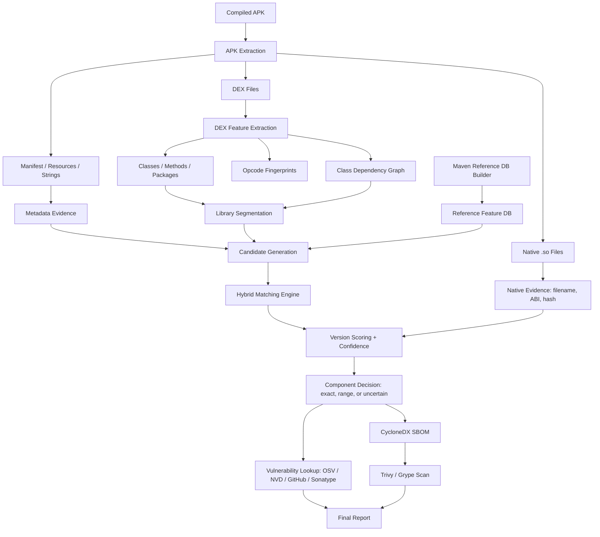

# Supervisor MVP Proposal: APK-to-SBOM Recovery for Android Applications

## 1. Project Title

**Evidence-Based SBOM Recovery from Compiled Android APKs Using Hybrid Static Library Version Detection**

## 2. Problem

Traditional SBOM tools usually work best when source code, Gradle files, package manifests, or build metadata are available. However, in many Android security-audit scenarios, the only available artifact is a compiled APK.

Inside a compiled APK, third-party libraries are embedded into DEX bytecode. Their original Maven coordinates and versions may be missing, renamed, optimized, or partially removed by ProGuard/R8.

The project problem is:

```text
Given only a compiled Android APK, recover third-party libraries and versions,
generate a standard SBOM, and identify vulnerabilities affecting those versions.
```

## 3. Proposed MVP

The MVP will be a static APK analysis pipeline:

```text
APK
-> extract DEX, manifest, resources, strings, and native files
-> recover classes, methods, opcodes, and dependency relationships
-> compare against a Maven reference database
-> identify library and version candidates with confidence
-> generate CycloneDX SBOM
-> query vulnerability sources for detected versions
-> produce a final report
```

## 4. Architecture



## 5. What The MVP Will Handle

| Case | Support |
|---|---|
| Standard single APK files | Yes |
| Multidex APKs | Yes |
| Java/Kotlin Maven libraries | Yes |
| Libraries present in the reference DB | Yes |
| Library name detection | Yes |
| Version detection | Yes, with confidence |
| Exact version detection | Yes, when evidence is strong |
| Version range / uncertain candidates | Yes |
| Basic obfuscation: renaming | Partial to good |
| Dead-code removal / shrinking | Partial |
| Heavy R8 optimization | Limited |
| Native `.so` files | Basic extraction/hash only |
| CycloneDX SBOM generation | Yes |
| CVE/advisory lookup | Yes |

## 6. What The MVP Will Not Handle

| Case | Reason |
|---|---|
| Packed/encrypted APKs | Static analysis cannot see hidden code directly. |
| Dynamic code loading | Code downloaded at runtime is not present in the APK. |
| Commercial anti-reverse-engineering protection | Too complex for first MVP. |
| Perfect heavy R8 recovery | Even recent research tools struggle with this. |
| Complete native `.so` version identification | Separate hard research problem. |
| All Maven libraries | The MVP starts with a selected reference database. |
| Libraries absent from the reference DB | Exact version cannot be confidently identified. |

## 7. Tools

| Level | Tool | Use |
|---|---|---|
| Main implementation | Python | CLI, feature extraction, matching, SBOM, APIs. |
| APK extraction | Python `zipfile` | Extract raw APK contents. |
| Manifest/resources | Apktool, Androguard | Decode manifest, resources, strings. |
| DEX parsing | Androguard | Extract classes, methods, opcodes, references. |
| Manual verification | JADX | Inspect APKs during testing/debugging. |
| Reference libraries | Maven Central | Download selected JAR/AAR versions. |
| JAR/AAR to DEX | Android D8 | Convert references to comparable DEX form. |
| Storage | SQLite | Store reference features and analysis results. |
| Graph analysis | NetworkX | Build class dependency graphs. |
| SBOM | CycloneDX JSON | Standard machine-readable SBOM output. |
| SBOM validation | cyclonedx-cli | Validate generated SBOMs. |
| Vulnerability lookup | OSV API first | Query vulnerabilities using package/version/PURL. |
| Optional scanning | Trivy / Grype | Scan generated CycloneDX SBOM. |
| Evaluation | R8 / ProGuard / Obfuscapk | Test obfuscation resilience. |

## 8. Research Justification

The architecture is based on findings from Android TPL detection and SBOM research:

| Research lesson | Supporting work | MVP decision |
|---|---|---|
| Package names are fragile. | LibRadar limitations, LibScout, systematic assessment. | Use package names only as weak evidence. |
| Reference versions are required for version detection. | LibScout, ATVHunter, LibID, LibScan, SAD. | Build Maven reference DB. |
| App/library segmentation is necessary. | LibSift, LibD, LibPecker. | Add library segmentation stage. |
| Graph features improve obfuscation resilience. | LibPecker, SAD, LibMD. | Use class dependency graph. |
| Opcode/CFG features help version detection. | LibID, LibScan, ATVHunter. | Use opcode fingerprints; CFG optional later. |
| R8 is difficult and must be evaluated. | LibHunter, LibAttention, robustness studies. | Report confidence; do not claim R8-proof detection. |
| Exact version enables CVE lookup. | ATVHunter, OSSPolice, Keep me Updated. | Add OSV/NVD/GitHub/Sonatype lookup after version scoring. |
| Standard SBOM output is required. | CISA, CycloneDX, Trivy, Grype. | Generate CycloneDX SBOM with PURL and evidence. |

## 9. Expected Deliverables

1. Static APK analyzer prototype.
2. Small Maven reference database for selected libraries and versions.
3. Hybrid matching engine using metadata, class, opcode, and graph evidence.
4. Version scoring with confidence.
5. CycloneDX SBOM generator.
6. Vulnerability lookup module.
7. Evaluation on controlled APKs with known dependencies.
8. State-of-the-art and architecture documentation.
9. Final PFE report and presentation.

## 10. Evaluation Plan

The MVP will be evaluated on controlled APKs built with known dependencies.

Planned variants:

```text
clear APK
ProGuard/R8 rename
R8 shrink
R8 shrink + optimize
```

Metrics:

- library-level precision, recall, F1
- version-level precision, recall, F1
- exact/range/uncertain decision rate
- runtime per APK
- CycloneDX validity
- vulnerability lookup success

Baselines:

- package-name matching
- class-name/class-overlap matching
- hash matching
- optional LibScout/other available baseline if setup is feasible

## 11. One-Month Implementation Plan

| Week | Goal |
|---|---|
| Week 1 | Project setup, APK extraction, DEX parsing, first reference DB schema. |
| Week 2 | Maven reference downloader, D8 conversion, basic feature extraction, first matcher. |
| Week 3 | Version scoring, CycloneDX generation, OSV lookup, controlled test APKs. |
| Week 4 | Obfuscation evaluation, results tables, limitations, final report/presentation. |

## 12. Main Contribution

The project contribution is not a new APK parser or a new vulnerability database. The contribution is:

```text
An evidence-based APK-to-SBOM pipeline that adapts Android third-party library
version detection techniques into a practical CycloneDX SBOM and vulnerability workflow.
```

## 13. Final Scope Statement

The MVP targets standard compiled Android APKs containing known Java/Kotlin Maven libraries. It supports multidex extraction, partial obfuscation resilience, version confidence scoring, CycloneDX SBOM generation, and vulnerability lookup. Packed APKs, dynamic loading, full native version identification, and perfect heavy R8 recovery are outside the first MVP scope and will be treated as limitations or future work.

